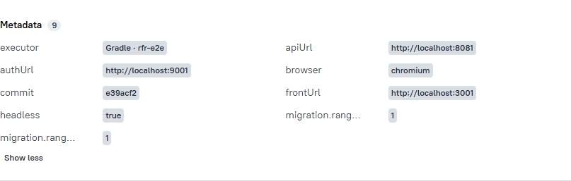

# ДЗ 4: жизненный цикл расширений JUnit и окружение Allure

Отчёт составлен по истории ветки `hw-4`, исходникам и фактически выполненным проверкам. Проверяемое итоговое состояние — `d90f7f2`. Все временные мутации, описанные ниже, отменены; в итоговом коде их нет.

**Статус: основные реализации и эксперименты выполнены, но полный Definition of Done пока не подтверждён.** Ниже отдельно перечислены оставшиеся проверки и расхождение требования об отсутствии обращений к стенду с текущей реализацией Allure.

## Исходное состояние и история

Опорный коммит занятия — `74706f1` (`Урок 4: добавил SuiteExtension и настроить окружение`). В истории перед ним есть результат предыдущего ДЗ. Независимая сверка полного состояния с записью занятия или бандлом не проводилась; точное совпадение с концом занятия и исходный зелёный прогон этим отчётом не подтверждаются.

| Изменение | Коммит | Отмена |
|---|---|---|
| Перенос проверки миграций в `@BeforeSuite` | `5fc9ef5` | Следующий коммит `445b9bf`, создан через `git revert` |
| Перенос проверки в `LauncherSessionListener` | `ef44929` | Следующий коммит `a4c126b`, создан через `git revert` |
| Удаление корневой обёртки `e2e`, мешавшей `--tests` | `9fd5bfe` | Сохранено |
| Ожидание стенда через `StandReadinessExtension` | `e39acf2` | Сохранено |
| Запись окружения через `AllureEnvironmentExtension` | `e28b7f5` | Сохранено |
| Актуализация агента и навыка ревью | `d90f7f2` | Сохранено |

В истории также есть более ранняя пара попытки suite и её отмены: `da16b62` / `1644fe7`. Результаты задачи 1 ниже относятся к `5fc9ef5`.

## 1. StandSchemaExtension через @BeforeSuite

В эксперименте добавлена зависимость `junit-platform-suite`, создан `StandSuiteTest` с `@Suite`, выбором UI-тестов и статическим `@BeforeSuite`. Регистрация `StandSchemaExtension` в Jupiter ServiceLoader убрана. Для окончательной настройки эксперимента внешний движок Gradle ограничен `junit-platform-suite`, внутри suite используется `junit-jupiter`.

| Проверка | Результат |
|---|---|
| `./gradlew e2e` с ограничением движка | 16 UI-тестов прошли, каждый выполнен один раз |
| Тот же запуск без ограничения движков | Каждый UI-тест выполнен дважды: 32 выполнения для 16 методов; дополнительно Jupiter обнаружил проверки расширений и демонстрационные тесты |
| Прямой запуск `FriendsTabTest` через обычную задачу `test` | Два теста прошли при включённом свойстве миграций и неверном пути миграций: suite-callback обойдён |
| Прямой запуск одного метода через обычную задачу `test` | Один тест прошёл с теми же диагностическими настройками; `@BeforeSuite` не вызван |
| Один класс или метод непосредственно через JUnit в IDE | По модели JUnit suite не выбран, поэтому callback не должен вызываться; именно этот эксперимент фактическим IDE-прогоном не подтверждён из-за таймаута тогдашнего MCP |
| Точная команда `./gradlew e2e --tests '*TabTest'` в состоянии эксперимента | Ошибка разбора параметров: корневая задача-обёртка не поддерживала `--tests`; тесты и callback не запущены |
| `./gradlew :rfr-e2e:e2e --tests '*TabTest'` | Шесть тестов вкладок прошли через suite; неверный путь миграций приводит к падению `@BeforeSuite` |

После отмены эксперимента корневая обёртка удалена отдельным коммитом. В текущей версии `./gradlew e2e --tests '*TabTest'` выбирает модульную задачу `Test` и поддерживает фильтр; проверки работают через `SuiteExtension`.

Ошибка `@BeforeSuite` проверялась отсутствующим каталогом миграций, без изменения БД. Gradle показывает:

```text
StandSuiteTest > initializationError FAILED
    java.lang.IllegalStateException
1 test completed, 1 failed
BUILD FAILED
```

Код завершения Gradle — 1, тела UI-тестов не выполняются. Allure Java пишет глобальную ошибку `Container StandSuiteTest failed, tests inside it did not run` в `*-globals.json`; результатов отдельных UI-тестов нет. В Allure 3 ошибка находится в глобальных ошибках, при этом сводка такого изолированного отчёта содержит `stats.total=0` и `status="passed"`. Поэтому статус сводки не заменяет код завершения Gradle.

## 2. StandSchemaExtension через LauncherSessionListener

В отдельной попытке `StandSchemaExtension` реализовывал `LauncherSessionListener`, сверка выполнялась в `launcherSessionOpened`, регистрация перенесена в соответствующий service-файл. `junit-platform-launcher` переведён из `testRuntimeOnly` в `testImplementation`. Эта попытка также отменена через `git revert`.

| Проверка | Результат |
|---|---|
| `./gradlew :rfr-e2e:test`, без UI | Слушатель вызван один раз; маркер с PID `32736` и `migrationCheck=false` отличает открытие сессии от фактической сверки БД |
| Тот же набор при `maxParallelForks=2` | Два вызова с разными PID: `14908` и `1720`, по одному на запущенный тестовый процесс |
| `SuiteExtensionTest` через `EngineTestKit` | Все 22 проверки прошли, маркер внешней сессии один; внутренние `EngineTestKit.engine(...).execute()` новых launcher-сессий не создают |
| Исключение в `launcherSessionOpened` под Gradle | `TestSuiteExecutionException`, `Could not start Gradle Test Executor`, исходный `IllegalStateException`; код завершения 1 до начала тестов |
| JUnit-конфигурация класса из IDE через MCP `idea` | 22 теста прошли, один вызов слушателя, код завершения 0 |
| JUnit-конфигурация метода из IDE через MCP `idea` | Один тест прошёл, один вызов слушателя, код завершения 0 |
| Исключение слушателя в JUnit-конфигурации IDE | `Internal Error occurred.` и исходный стек; код завершения `-2`, событий начала отдельных тестов нет |

Два вызова при `maxParallelForks=2` относятся к проверенному набору: это верхний предел числа процессов, а не универсальная гарантия ровно двух сессий для любого фильтра или конфигурации.

### SuiteExtension / @BeforeSuite / LauncherSessionListener

| Подход | Когда срабатывает | Запуск из IDE | Store и теги | Как падает |
|---|---|---|---|---|
| `SuiteExtension` | В `beforeAll` первого выбранного Jupiter-класса, один раз на реализацию в корневом контексте; отдельный корень внутри `EngineTestKit` | Видит прямой запуск класса или метода при включённой глобальной автозагрузке | Получает `ExtensionContext.Store`; есть контекст Jupiter, но теги корня не являются объединением тегов всех тестов | Ошибка контейнеров классов; сохранённая ошибка повторно выдаётся следующим классам, тела тестов не выполняются |
| `@BeforeSuite` | Перед тестами явно выбранного `@Suite` | Видит запуск suite; прямой запуск тестового класса или метода его обходит | Нет Jupiter `ExtensionContext.Store`; отбор по тегам задаёт suite, а callback не получает контекст выбранного тестового метода | `initializationError` suite в Gradle; глобальная ошибка контейнера в Allure |
| `LauncherSessionListener` | При открытии каждой launcher-сессии до discovery и фильтрации | Прямой JUnit-запуск класса и метода подтверждён через IDE | Нет Jupiter Store, но в JUnit 6.1.3 есть собственный `LauncherSession.getStore()`; в `launcherSessionOpened` ещё нет плана и тегов выбранных тестов | Ошибка открытия сессии: Gradle не может запустить executor, IDE сообщает `Internal Error occurred.` |

В проекте остаётся `SuiteExtension`, поскольку нужен корневой контекст Jupiter, его Store и одинаковая работа при обычном запуске и внутри `EngineTestKit` без обязательного suite-класса.

## 3. StandReadinessExtension

Итоговая реализация использует `SuiteExtension.beforeSuite`, адреса берёт из `TestConfig`. `e2e` включает `rfr.standCheck=true` и `rfr.migrationCheck=true`; обычный `test` сам их не включает. Общий срок `rfr.standTimeout` по умолчанию — 180 секунд.

| Сервис | Проверка | Подсказка при ошибке |
|---|---|---|
| MySQL | TCP-соединение к хосту и порту `dbUrl` | `docker compose up -d --wait` |
| rfr-auth | GET `/.well-known/openid-configuration`, HTTP-код меньше 400 | `./gradlew runAll` |
| rfr-api | POST `/graphql` с `{"query":"{__typename}"}`, любой HTTP-ответ, как у исходного `curl` без `-f` | `./gradlew runAll` |
| rfr-gql-client | GET страницы фронтенда, HTTP-код меньше 400 | `cd rfr-gql-client && npm run dev` |

Используется общий монотонный срок. Каждая попытка ограничена меньшим из пяти секунд и оставшегося времени; есть connect/request timeout и внешний лимит ожидания `Future`, покрывающий DNS и тело ответа. Пауза между попытками — до 200 мс. Прерывание сохраняет флаг потока. Socket, HTTP-клиент, Future и executor имеют предусмотренное завершение. HTTP-пробы используют HTTP/1.1, чтобы не отправлять Vite протокольный Upgrade вместо обычного запроса страницы.

`e2e` не зависит от `waitForStand`. Задача Exec сохранена для ручного запуска; в GitHub Actions она вызывается отдельным шагом перед `e2e`. Это отдельная проверка CI, а не зависимость задачи тестов.

Пять проверок `StandReadinessExtensionTest` используют `@ProbeTarget`, `EngineTestKit`, `HttpServer` на эфемерном порту и подставной TCP-слушатель: задержка ответа на 2 секунды; исчерпание срока без выполнения теста; отсутствие запросов при выключенной проверке; ограничение зависшего HTTP-тела; порядок ServiceLoader.

Из IDE через MCP `idea` проверен `MainPageTest` с `-Drfr.standCheck=true`, сроком 2 секунды и адресом фронтенда без слушающего сервиса. Получена ошибка `Class Configuration` с именем `rfr-gql-client` и командой запуска, код `-1`; тело UI-теста не выполнялось. Работающий фронтенд при этой проверке не останавливался. При `standCheck=false` прямой запуск из IDE ожидание не включает — свойство нужно задать в конфигурации.

## 4. AllureEnvironmentExtension и порядок расширений

В итоговом `META-INF/services/org.junit.jupiter.api.extension.Extension`:

```text
io.student.rangiffler.jupiter.extension.AllureEnvironmentExtension
io.student.rangiffler.jupiter.extension.StandReadinessExtension
io.student.rangiffler.jupiter.extension.StandSchemaExtension
```

Производственные реализации не подключены через `@ExtendWith`. Порядок строк внутри одного service-файла сохраняет `ServiceLoader`, порядок регистрации before-callbacks сохраняет Jupiter. Когда обе проверки включены, readiness завершается раньше schema. Синхронизированный `SuiteRun.start()` заставляет параллельные классы дождаться той же проверки и повторно выдаёт сохранённую ошибку без нового ожидания.

После падения before-callback Jupiter не вызывает следующие before-callbacks. Поэтому Allure зарегистрирован первым: его `SuiteRun` попадает в корневой Store до потенциального сбоя подготовки. При штатном закрытии Store вызывается `afterSuite`, даже если readiness или schema завершились ошибкой.

`afterSuite` записывает `environment.properties` в `allure.results.directory`; без свойства используется `rfr-e2e/build/allure-results` относительно рабочей директории. Gradle-плагин передаёт абсолютный путь. Файл содержит восемь ключей: `frontUrl`, `authUrl`, `apiUrl`, `browser`, `headless`, `commit`, `migration.rangiffler-auth`, `migration.rangiffler-api`.

Короткий хеш получает Gradle и передаёт как `rfr.commit`: тест Git не запускает. Версии читает Flyway через отдельные подключения с connect/socket timeout по 1000 мс и без повторов подключения. Недоступная схема записывается как `unavailable`, отсутствие текущей версионной миграции — как `none`. Ошибка записи файла не скрывается. Пароль и имя пользователя БД в файл не включаются.

Три проверки `AllureEnvironmentExtensionTest`: все ключи после успешного прогона во временном каталоге; файл после падения другого `beforeSuite` и невызванный следующий callback; обе версии `unavailable` при недоступной MySQL.

### Скриншот Environment из allureServe

В используемом Allure Report 3.17.0 этот блок называется **Metadata**. Скриншот получен из отчёта, запущенного `./gradlew allureServe`; хеш на снимке — `e39acf2`, обе версии схем — `1`. Поле `executor` добавляет Gradle-плагин. Общая статистика того отчёта включает предыдущие запуски и не является результатом одного текущего прогона.



Файл для прикрепления к PR: `docs/hw4/allure-environment.png`.

## 5. AI-ревью и отрицательные проверки

Независимый `test-reviewer` использовал актуальные `.claude/agents/test-reviewer.md` и `.claude/skills/rfr-test-review/SKILL.md`. Проверена новая область диапазона `74706f1..d90f7f2`; старые дефекты расширений пользователей не выдавались за новые.

**Подтверждено запуском — вывод самого ревьюера:** тесты в независимом ревью не запускались. Прогоны основного агента перечислены отдельно ниже.

**По чтению кода — вывод ревьюера:**

- Дефектов владения ресурсами в итоговой новой реализации не найдено. Store, Future, соединения, серверы и файловые потоки имеют владельцев и предусмотренное завершение.
- **[P2, открытое расхождение с DoD]** `AllureEnvironmentExtension.java:26–30` безусловно читает версии MySQL через `FlywaySchemaVersion`. Поэтому обычный `test` не выполняет readiness, но всё равно обращается к стенду за метаданными. Это не утечка ресурсов; буквальный критерий «test не обращается к стенду» не выполнен. Кроме того, существующий `UserExtensionTest` сам проверяет данные реальной БД.
- Временная мутация распознана: **[P1, правило 13] `MainPageTest.java:16`**, `@ExtendWith(StandReadinessExtension.class)` вне `@ProbeTarget` нарушает правило глобальной регистрации. После удаления провайдера из services, например, `FriendsTabTest` остаётся без ожидания. Глобальная сверка схемы также может выполняться раньше локальной readiness.
- Мутация исправлена восстановлением service-файла и удалением `@ExtendWith`. Инвариант регистрации покрывает `StandReadinessExtensionTest.readinessPrecedesSchema`, входящий в оба успешных итоговых запуска `test`.

**Не проверено самим ревьюером:** свежие прогоны ×2, реальные остановка/запуск фронтенда и красные мутации. Ревьюер проверял мутацию правила 13 по diff; исполнение проверок выполнял основной агент.

| Диагностическая правка | Фактический результат | Итоговое состояние |
|---|---|---|
| Удалить readiness из services и добавить `@ExtendWith` в `MainPageTest` | Независимый агент выдал приведённое замечание P1 по правилу 13 | Правка отменена, инвариант проверен зелёными тестами |
| Убрать повтор опроса: временно заменить условие цикла на `false` | `waitsForDelayedService` красный: один тест, одна ошибка, Gradle exit 1 | Цикл восстановлен; проверка входит в оба зелёных запуска `test` |
| Переставить Allure после schema, задать отсутствующий каталог миграций и включить сверку | Gradle exit 1; в новом изолированном каталоге `environment.properties` отсутствует | Порядок восстановлен |
| Правильный порядок и тот же сбой schema | Gradle exit 1; `environment.properties` существует | Ожидаемая обработка сбоя |
| Правильный порядок, сбой подготовки и адрес MySQL без сервиса | Gradle exit 1; файл существует, обе версии — `unavailable` | Недоступность проверена подменой адреса, без остановки работающей MySQL |

Рабочие исходники после всех мутаций совпадают с `HEAD`. Промежуточный запуск обычных тестов, пересёкшийся с мутацией регистрации, не засчитан как финальная проверка. После восстановления выполнены два новых успешных запуска.

## 6. Матрица приёмки и оставшиеся пункты

| Требование или проверка | Статус |
|---|---|
| Три расширения в services в обоснованном порядке | Выполнено |
| Нет производственной регистрации этих расширений через `@ExtendWith` | Выполнено; временная мутация отменена |
| `e2e` не зависит от `waitForStand` | Выполнено |
| Попытки задач 1 и 2 есть в истории и отменены следующими revert-коммитами | Выполнено |
| Мишени `@ProbeTarget` не выполняются напрямую | Подтверждено: в итоговом обычном запуске все 33 вложенных контейнера `jupiter.probe` полностью пропущены; мишени включаются параметром вложенного `EngineTestKit` |
| `./gradlew :rfr-e2e:test` ×2 на восстановленном текущем коде | Оба успешны, 10 и 19 секунд |
| `./gradlew e2e` ×2 на окончательном состоянии | Не подтверждено. После задачи 3 был успешный прогон 16 UI-тестов; последняя проверка после задачи 4 остановилась на readiness фронтенда за 180 секунд |
| Реальный фронтенд остановлен, затем `npm run dev` запущен во время ожидания и e2e проходит | Не выполнено; есть проверка задержанного подставного сервиса, но она не заменяет этот сценарий |
| Реальный фронтенд не запущен, `rfr.standTimeout=10`, ошибка называет его | Именно этот сценарий не выполнен; IDE-проверка использовала недоступный адрес и срок 2 секунды |
| Нулевая сетевая активность `:rfr-e2e:test` к стенду | Не выполнено буквально: чтение версий Allure и существующие проверки пользовательских данных обращаются к MySQL |
| Красные проверки повторного опроса и неправильного порядка Allure | Выполнены, все мутации восстановлены |
| Allure-файл при буквально остановленной MySQL | Проверен эквивалент недоступного адреса MySQL; сам работающий контейнер не останавливался |
| Прямой IDE-запуск класса и метода в историческом эксперименте `@BeforeSuite` | Остался неподтверждённым; IDE-проверки слушателя из задачи 2 выполнены отдельно |
| Каждое принятое замечание ревью закрыто мишенью | Мутация правила 13 восстановлена и покрыта проверкой порядка; P2 по буквальному DoD остаётся открытым и не объявляется исправленным |

Следовательно, перед заявлением полного выполнения DoD нужно согласовать смысл «test не обращается к стенду» либо изменить соответствующее поведение, получить два успешных финальных `e2e` и выполнить перечисленные сценарии с реальной остановкой и запуском сервисов. Эти результаты не подменяются предположениями или зелёной статистикой старого отчёта Allure.

### Свидетельства проверок

Отобранные материалы перенесены из локальных build-каталогов в [evidence](evidence/README.md) рядом с отчётом: логи обеих попыток, подтверждение двойного выполнения, ошибки Gradle и IDE, два итоговых запуска `test`, красные проверки и примеры `environment.properties`. Они доступны для включения в PR независимо от очистки `build/`. Падения в диагностических логах намеренные; результаты не подменяют оставшиеся неподтверждённые пункты матрицы.
